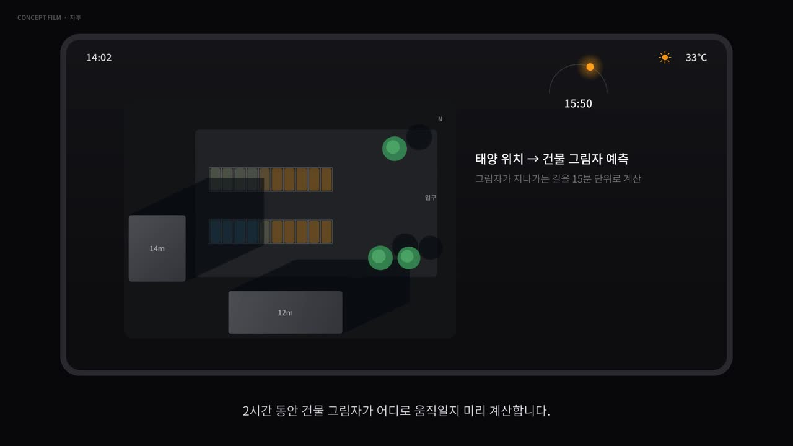

<div align="center">

# 차후

**여름에는 그늘 자리를, 겨울에는 햇볕 자리를 찾아 주는 차량용 주차 앱**

차후(此後)는 '나중'이라는 뜻입니다. 차(車)를 세운 뒤, 나중에 돌아왔을 때를 먼저 계산합니다.




<sub>시연 영상의 한 장면입니다. 실제 앱 화면은 아래 '지금 동작하는 것'을 참고해 주세요.</sub>

</div>

> 현대자동차그룹 차량용 앱 개발 공모전 출품작 · 주요 기능은 **그늘·햇볕 자리 추천**입니다.

## 무엇을 하는 앱인가요

야외 주차장에 들어설 때 지금 그늘인 칸을 골라도, 두 시간 뒤에는 해가 움직여 땡볕이 되곤 합니다.
차후는 주차하는 동안 해가 어떻게 움직이는지 계산해서, **그 시간 동안 그늘이 가장 오래 유지되는 칸**을 알려 줍니다.

1. 태양의 고도와 방위를 시각별로 계산합니다.
2. 건물과 나무가 만드는 그림자를 다각형으로 그립니다.
3. 주차 시간 동안 15분 간격으로 칸마다 그늘 비율을 구해 평균을 냅니다. 이 값이 **그늘 유지율**입니다.
4. 그늘 유지율이 높은 칸부터 추천하고, 평면도에 표시합니다.

## 지금 동작하는 것 (v0.1)

| 기능 | 설명 |
| --- | --- |
| 태양 위치 계산 | SunCalc 알고리즘을 Kotlin으로 옮겼습니다. 외부 라이브러리가 없습니다. |
| 그림자 계산 | 건물 바닥면과 높이, 나무 수관으로 그림자 다각형을 만듭니다. |
| 칸별 그늘 유지율 | 주차 시간(1·2·3시간) 동안의 평균 그늘 비율로 순위를 매깁니다. |
| 주차장 평면도 | 시각 슬라이더를 움직이면 그림자가 따라 움직입니다. |
| 추천과 음성 안내 | "주차할 곳 알려줘"를 누르면 추천 칸을 강조하고 음성으로 읽어 줍니다. |
| 출발 시 온도 기록 | 실내 온도를 수동으로 입력하면 다음 추천에 반영됩니다. (시연용) |

주차장 데이터는 샘플 1곳입니다. 차량 연동은 아직 임시 구현입니다.

## 앞으로 붙일 것

| 기능 | Pleos Connect SDK |
| --- | --- |
| "주차할 곳 알려줘" 음성 요청 | SpeechToText |
| 추천 결과 음성 안내 | TextToSpeech |
| 주차장 입구까지 경로 요청, 도착 감지 | NaviHelper |
| 외기 온도에 따라 그늘/햇볕 모드 묻기 | Vehicle (AAOS Car API) |
| 출발 시 실내 온도로 예측 확인 (고도화) | Vehicle · 지원 여부 확인 필요 |

연결할 자리는 `app/src/main/java/com/chahu/app/pleos/`의 `TODO(Pleos)` 주석에 표시해 두었습니다.
겨울 햇볕 모드는 같은 계산의 순위를 뒤집는 방식으로 추가할 예정이며, 아직 구현하지 않았습니다.

## 실행 방법

1. Android Studio에서 이 폴더를 엽니다.
2. Gradle JDK를 **21**로 맞추고 동기화가 끝날 때까지 기다립니다. (Settings → Build Tools → Gradle)
3. 에뮬레이터를 켜고 `app`을 Run 합니다.
4. 슬라이더로 시각을 바꾸고, **"주차할 곳 알려줘"** 를 눌러 봅니다.

엔진 단위 테스트는 `./gradlew test`로 실행합니다.

### 확인한 환경

- Android Studio + Android 에뮬레이터 (Medium Phone, API 36)
- Gradle 8.7 · Android Gradle Plugin 8.5.2 · Kotlin 1.9.24 · JDK 21
- 가로 화면 전용, 시연 날짜는 여름 그림자를 보이려고 2026-08-14로 고정했습니다. (`MainActivity.demoDate`)

## 구조

```
app/src/main/java/com/chahu/app/
├─ engine/   SunPosition · Geometry · ShadeEngine  (순수 Kotlin, 테스트 대상)
├─ data/     LotRepository (주차장 JSON) · HistoryStore (확인 기록)
├─ ui/       ParkingMapView (평면도)
├─ pleos/    Pleos SDK 연결부 (현재 임시 구현)
└─ MainActivity.kt
```

## 주차장 데이터 형식

`app/src/main/assets/lots/sample_lot.json` — 기준점(lat, lon)에서의 미터 좌표를 씁니다. (x = 동, y = 북)

- `spaces` 주차 칸: 좌하단 x, y, 폭 w, 깊이 h
- `buildings` 건물: 볼록 다각형 바닥면과 `floors`(층수 × 3m) 또는 `height`
- `trees` 나무: 수관 중심, 반지름, 높이

## 표현 범위

차후가 안내하는 것은 **칸에 그늘이 지는 시간**입니다. 실내 온도나 안전 여부는 판단하지 않습니다.

